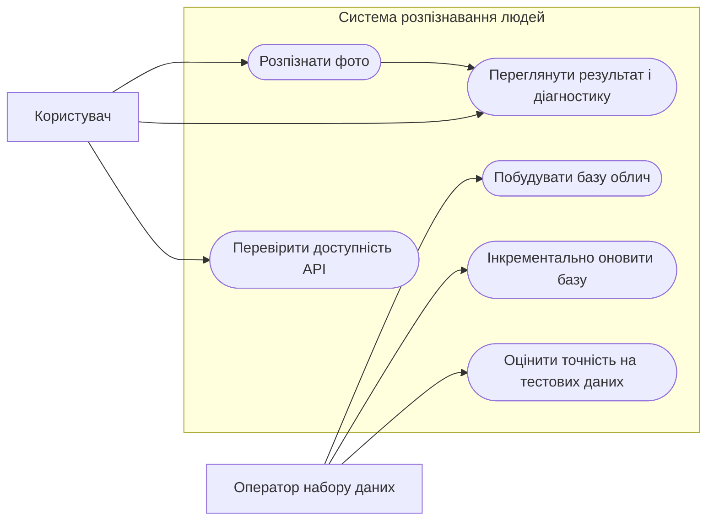

# Технічне завдання

## Система розпізнавання людей за фотографіями

**Версія:** 1.0  
**Статус:** навчальний проєкт

## 1. Загальні відомості

### 1.1. Назва системи

Система розпізнавання людей за фотографіями (далі — Система).

### 1.2. Мета розроблення

Розробити програмну систему, яка визначає, якій людині з підготовленої локальної групи належить обличчя на вхідній фотографії. Якщо обличчя не виявлено або схожість із відомими людьми нижча за налаштований поріг, система має повертати відповідно `no_face` або `unknown`, а не призначати непідтверджену особу.

### 1.3. Область застосування

Система призначена для навчальних і демонстраційних завдань із комп'ютерного зору: підготовки локальної бази облич, ідентифікації людей на фотографіях та оцінювання результатів на тестових даних. Система не є засобом підтвердження особи, контролю доступу чи біометричної автентифікації.

### 1.4. Терміни та скорочення

| Термін | Значення |
|---|---|
| Вектор ознак (embedding) | Числове представлення обличчя, яке обчислює модель для порівняння фотографій. |
| Поріг схожості | Мінімальне значення схожості, за якого найкращий кандидат повертається як розпізнана людина. |
| `unknown` | Обличчя знайдено, але схожість із відомими людьми недостатня. |
| `no_face` | На зображенні не знайдено обличчя. |
| CLI | Інтерфейс командного рядка. |
| API | Програмний інтерфейс для взаємодії із сервером. |

## 2. Призначення та користувачі

Система автоматизує підготовку бази векторів облич, розпізнавання окремих або пакетних зображень і базове оцінювання точності. Вона має такі ролі:

| Роль | Призначення |
|---|---|
| Оператор набору даних | Розміщує фотографії у каталогах людей, запускає побудову або оновлення бази й оцінювання на тестових даних. |
| Користувач | Передає фотографію через вебінтерфейс, HTTP API або CLI та переглядає результат розпізнавання. |

Автентифікація та розмежування доступу між ролями не входять до поточної версії Системи.

## 3. Функціональні вимоги

| ID | Вимога | Критерій приймання |
|---|---|---|
| FR-01 | Система повинна завантажувати фотографії відомих людей із каталогів `data/people/<ім'я>/`. Назва каталогу є міткою людини. | Під час побудови бази фотографії з різних каталогів потрапляють до відповідних записів; підтримуються `.jpg`, `.jpeg`, `.png`, `.bmp`, `.webp`. |
| FR-02 | Система повинна знаходити обличчя на фотографіях і обчислювати для знайденого обличчя нормалізований вектор ознак. | Для фотографії з обличчям створюється вектор; фотографія без обличчя пропускається під час побудови бази з відповідним повідомленням. |
| FR-03 | Оператор повинен мати змогу побудувати базу розпізнавання з нуля та зберегти її у `data/models/embeddings.pkl`. | Команда `learn` створює файл бази, якщо є придатні фотографії. |
| FR-04 | Оператор повинен мати змогу інкрементально додати до бази нові фотографії, не обчислюючи повторно вектори вже опрацьованих файлів. | Команда `learn --incremental` додає нові файли й зберігає відомості про вже опрацьовані фотографії. |
| FR-05 | Система повинна визначати найкращого кандидата за косинусною схожістю вектора вхідного обличчя з векторами бази. | Кандидати ранжуються за спаданням схожості; для людини використовується найбільша схожість серед її збережених фотографій. |
| FR-06 | Система повинна повертати ім'я найкращого кандидата, якщо його схожість не нижча за поріг; інакше — `unknown`. | Порівняння виконується з порогом `THRESHOLD`, за замовчуванням `0.5`; поріг можна передати для команд `identify` та `test`. |
| FR-07 | Якщо на вхідному зображенні не виявлено обличчя, система повинна повертати `no_face`. | Для такого результату схожість дорівнює `0.0`, а дані кандидатів і ймовірність детекції відсутні. |
| FR-08 | CLI повинна розпізнавати як окремий файл, так і всі підтримувані зображення у каталозі; без явного шляху використовується `data/queries/`. | Команда `identify` обробляє переданий файл або каталог і виводить результат для кожного зображення. |
| FR-09 | Після пакетного розпізнавання CLI повинна зберігати основні результати та діагностичні дані у CSV-файли. | Створюються `data/output/results.csv` і `data/output/identify_diagnostics.csv`; діагностика містить найкращого й другого кандидата, схожість, margin, ймовірність детекції та поріг. |
| FR-10 | CLI повинна оцінювати розпізнавання на даних із `data/test/<очікувана мітка>/`. | Команда `test` порівнює передбачення з назвою каталогу та виводить кількість правильних відповідей, загальну точність і кількість зображень без обличчя. |
| FR-11 | HTTP API повинно надавати перевірку доступності та endpoint для розпізнавання одного зображення. | `GET /health` повертає статус; `POST /identify` приймає файл у полі multipart-форми `file` і повертає результат у JSON. |
| FR-12 | API повинно відхиляти порожній, некоректний або завеликий файл із відповідним HTTP-повідомленням. | Порожній або непрочитуваний файл дає HTTP 400; файл понад 1 МБ — HTTP 413. |
| FR-13 | Відповідь API повинна містити прогноз і дані, необхідні для пояснення результату. | JSON містить `prediction`, `similarity`, `face_probability`, `best_candidate`, `second_candidate`, `margin` і `threshold`. |
| FR-14 | Вебінтерфейс повинен дозволяти вибрати, перетягнути або вставити з буфера обміну зображення, запустити розпізнавання та переглянути результат або помилку. | Після надсилання інтерфейс показує відповідь API та діагностичні відомості про запит; під час обробки повторний запуск заблоковано. |

## 4. Нефункціональні вимоги

| ID | Категорія | Вимога |
|---|---|---|
| NFR-01 | Сумісність | Система повинна запускатися в Docker Compose; API реалізується на FastAPI, вебклієнт — на Next.js. CLI має запускатися у контейнерному середовищі проєкту. |
| NFR-02 | Модель | Для детекції облич використовується MTCNN, для обчислення векторів — InceptionResnetV1 із попередньо навченими вагами VGGFace2. Обчислення виконується на CUDA за її доступності, інакше — на CPU. |
| NFR-03 | Обмеження завантаження | Endpoint розпізнавання повинен обмежувати розмір вхідного файлу одним мегабайтом. |
| NFR-04 | Надійність | Якщо файл не є коректним зображенням або база розпізнавання відсутня під час запуску API, система повинна повідомити про помилку, а не повертати результат як успішне розпізнавання. |
| NFR-05 | Діагностованість | CLI повинна виводити результат обробки кожного файлу; API має повертати структуровані поля, що дозволяють оцінити схожість і неоднозначність між кандидатами. |
| NFR-06 | Зручність використання | Вебінтерфейс повинен показувати вибране зображення, стан обробки та результат або зрозуміле повідомлення про помилку. |
| NFR-07 | Приватність | Фотографії й похідні біометричні вектори зберігаються локально в каталозі даних проєкту. Дані слід збирати лише за згодою людей і не використовувати для рішень із юридичними чи іншими значними наслідками. |
| NFR-08 | Продуктивність | Фіксований час відповіді не гарантується: він залежить від CPU/GPU та характеристик середовища. Для серійного навантаження потрібне окреме вимірювання продуктивності. |

## 5. Обмеження та припущення

1. База відомих людей попередньо підготовлена оператором у структурі `data/people/<ім'я>/`; якість результатів залежить від якості й репрезентативності цих фотографій.
2. Для запуску API файл бази `data/models/embeddings.pkl` має бути створений заздалегідь командою `learn`.
3. За відсутності порога в конфігурації використовується значення `0.5`. Його потрібно перевіряти на окремому тестовому наборі, зокрема на фотографіях людей, яких немає в базі.
4. Для побудови бази, пакетного розпізнавання та тестування CLI підтримує формати `.jpg`, `.jpeg`, `.png`, `.bmp`, `.webp`.
5. Вебклієнт передає запит через Next.js API-маршрут до FastAPI; браузер не звертається безпосередньо до внутрішньої адреси API.
6. Поточна версія не передбачає реєстрації користувачів, редагування бази через вебінтерфейс, видалення біометричних даних через UI, журналу аудиту, гарантії точності або захисту від підміни фотографії.
7. Зовнішні залежності включають попередньо навчені ваги FaceNet/VGGFace2 та середовище Docker.

## 6. Користувацькі сценарії

## 7. Короткий опис архітектури

Система складається з таких компонентів:

1. **Вебклієнт Next.js** — приймає зображення від користувача, надсилає запит і показує JSON-результат та діагностику.
2. **API-маршрут Next.js** — проксіює запит браузера до сервісу FastAPI.
3. **FastAPI** — перевіряє файл, декодує зображення, серіалізує доступ до моделі та викликає модуль розпізнавання.
4. **Модуль розпізнавання** — отримує вектор обличчя через MTCNN і InceptionResnetV1, ранжує кандидатів і застосовує поріг схожості.
5. **CLI** — забезпечує побудову/оновлення бази, пакетне розпізнавання й оцінювання на тестовому наборі.
6. **Сховище даних** — каталоги фотографій, файл векторної бази `embeddings.pkl`, файл обліку опрацьованих зображень та CSV-результати. У Docker Compose каталог `data/` підключається як спільний том.

## 8. Вимоги до документації

До складу документації входять цей документ, README з інструкціями запуску, опис структури даних і команд CLI, а також автоматизовані тести основної логіки розпізнавання й оновлення бази.

## 9. Очікувані результати та приймання

Система вважається такою, що відповідає цьому ТЗ, якщо:

1. Оператор може побудувати базу з каталогів людей і додати нові фотографії інкрементально.
2. Для зображення з відомим обличчям повертається кандидат із найкращою схожістю, якщо вона відповідає налаштованому порогу.
3. Для зображення без обличчя повертається `no_face`, а для недостатньої схожості — `unknown`.
4. CLI формує CSV із пакетними результатами та оцінює якість на підготовленому тестовому наборі.
5. API повертає визначені поля JSON, коректно обробляє помилки зображення й дотримується обмеження завантаження 1 МБ.
6. Вебклієнт дозволяє передати зображення та показує результат або повідомлення про помилку.
7. Автоматизовані тести підтверджують щонайменше коректний збіг, випадок відсутності обличчя та відсутність повторного додавання вже опрацьованих файлів.

## 10. Висновок

Розроблювана Система автоматизує підготовку локальної бази облич, пошук найбільш схожої людини на фотографії та перевірку результатів на тестових даних. Вона надає CLI, HTTP API і вебінтерфейс, а невизначений результат явно позначає як `unknown` або `no_face`. Система призначена для навчального використання; точність залежить від даних і налаштування порога, тому результат не слід трактувати як достовірне підтвердження особи.